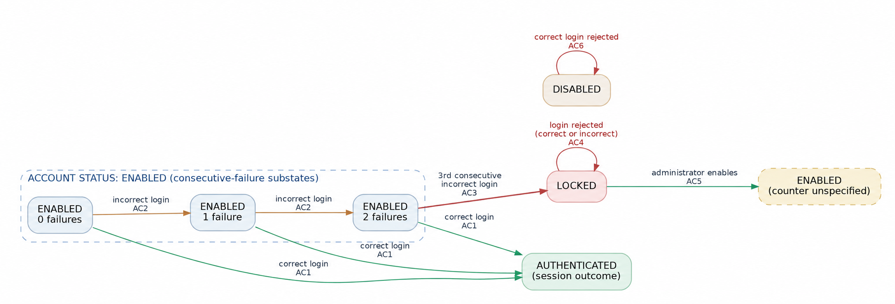

# Apply State Transition Testing on Toolshop

## Syllabus Reference
ISTQB Foundation Level – **4.2.4 State Transition Testing**

## Transfer Task
**Task:** [Apply State Transition Testing on Toolshop](https://github.com/rgroetz2/TBLL-AgileEngineeringFoundation/blob/main/courses/TestBusters-LearningLab/ISTQB-2026/foundationLevel/transferTasks/Chapter%204/ISTQB-FL-4.2.4_State_Transition_Testing_20260405.md)  
**Requirement source:** [user-login-ISTQBFL](https://github.com/rgroetz2/TBLL-AgileEngineeringFoundation/blob/main/courses/TestBusters-LearningLab/ISTQB-2026/foundationLevel/user-login-ISTQBFL.md)  
**Target release context:** Sprint 5 when relevant  

> **Scope / evidence:** This report is a requirement-based **test design**. No live Toolshop test execution or observed results are claimed. The provided user story is the source of truth; the sample diagram supplied by the coach is not treated as additional requirements.

## Outcome

### 1. Objective and Scope
Apply state transition testing to the account-protection login story. Identify states, events, guards, expected actions and next states; derive positive and negative sequences; design executable test cases; and document coverage and requirement gaps for Scrum review.

**In scope:** ENABLED login success/failure, three consecutive failures, LOCKED behavior, administrator enabling a LOCKED account, and correct-credential login while DISABLED.

**Out of scope until clarified:** How accounts become DISABLED or are re-enabled from DISABLED; logout behavior; the exact failed-attempt counter reset rules; invented controls or administrator actions not described in AC1–AC6.

### 2. Requirement Analysis (AC1–AC6)
| Requirement | Given / trigger | Required behavior |
| --- | --- | --- |
| AC1 | ENABLED + correct credentials + submit | User logs in successfully. |
| AC2 | ENABLED + incorrect credentials + submit | Login is rejected. |
| AC3 | Third **consecutive** incorrect login from ENABLED | Account becomes LOCKED; user is not logged in. |
| AC4 | LOCKED + any login attempt, including correct credentials | Login is rejected. |
| AC5 | LOCKED + administrator enables account | Account becomes ENABLED. |
| AC6 | DISABLED + correct credentials + login attempt | Login is rejected. |

**Modeling interpretation:** The story declares three **account statuses**: ENABLED, LOCKED and DISABLED. Because AC3 requires three consecutive failed login attempts, we divide ENABLED into three test states: 0, 1, and 2 previous failed attempts.
AUTHENTICATED represents a successful login, not a separate account state.
According to AC5, an administrator can change a LOCKED account to ENABLED. However, the user story does not explain what happens to the failed-attempt counter after this action. Therefore, we show the account as ENABLED without assuming a counter value.

### 3. States, Events, Conditions and Actions
| Element | Identifier / value | Meaning or source |
| --- | --- | --- |
| Account state | ENABLED | Allows login with correct credentials (AC1). |
| Account state | LOCKED | Blocks login; only administrator can enable it (AC4, AC5). |
| Account state | DISABLED | Correct credentials cannot log in (AC6). |
| Test substates | ENABLED (0), ENABLED (1), ENABLED (2) | Consecutive-failure history used to model AC3; not claimed as UI-visible statuses. |
| Session outcome | AUTHENTICATED | Indicates a successful login; not an account-status value (AC1). |
| Event | Submit login form | User submits credentials (AC1–AC4, AC6). |
| Event | Administrator enables account | Authorized administrator action (AC5). |
| Guard | Correct / incorrect credentials | Used with the current account status. |
| Guard | Number of preceding consecutive failures = 0, 1 or 2 | Determines whether another incorrect attempt advances the failure sequence or locks the account. |
| Actions | Authenticate, reject, record failure, lock, enable | Results specified or logically represented by AC1–AC6. |

**Counter convention:** The value in `ENABLED (n failures)` is the count **before the next login submission**. Guards therefore refer to prior failures, not the new count after the event.

### 4. State Transition Diagram (User-Story-Based)

**Diagram notes:**
- The arrow from LOCKED to `ENABLED (counter unspecified)` implements **AC5** without assuming that an administrator reset sets the count to zero.
- No arrows enter or leave DISABLED except the specified rejected-login self-loop (**AC6**). Account preparation for testing is separate from a product transition.
- No logout or authenticated-session reset behavior is drawn because it is not specified.
- The PNG diagram is included in the `assets` folder. It shows only the behaviors derived from AC1–AC6; no transition to or from DISABLED has been invented.

### 5. Valid State Transition Table
| ID | Current state | Event / input | Condition / guard | Expected action / result | Next state | Requirement |
| --- | --- | --- | --- | --- | --- | --- |
| V01 | ENABLED (0 failures) | Submit correct credentials | Account ENABLED; 0 prior consecutive failures | Login successful; user authenticated | AUTHENTICATED (session) | AC1 |
| V02 | ENABLED (0 failures) | Submit incorrect credentials | Account ENABLED; 0 prior consecutive failures | Login rejected; first failure recorded | ENABLED (1 failure) | AC2, AC3 |
| V03 | ENABLED (1 failure) | Submit correct credentials | Account ENABLED; 1 prior consecutive failure | Login successful; user authenticated | AUTHENTICATED (session) | AC1 |
| V04 | ENABLED (1 failure) | Submit incorrect credentials | Account ENABLED; 1 prior consecutive failure | Login rejected; second consecutive failure recorded | ENABLED (2 failures) | AC2, AC3 |
| V05 | ENABLED (2 failures) | Submit correct credentials | Account ENABLED; 2 prior consecutive failures | Login successful; user authenticated | AUTHENTICATED (session) | AC1 |
| V06 | ENABLED (2 failures) | Submit incorrect credentials | Account ENABLED; 2 prior consecutive failures | Login rejected; account locked on third failure | LOCKED | AC3 |
| V07 | LOCKED | Submit correct credentials | Account LOCKED | Login rejected; no authentication | LOCKED | AC4 |
| V08 | LOCKED | Submit incorrect credentials | Account LOCKED | Login rejected; no authentication | LOCKED | AC4 |
| V09 | LOCKED | Administrator enables account | Authorized administrator action | Account state becomes ENABLED | ENABLED (counter not specified) | AC5 |
| V10 | DISABLED | Submit correct credentials | Account DISABLED | Login rejected; no authentication | DISABLED | AC6 |

**Interpretation:** `V01`, `V03` and `V05` indicate successful authentication while the **account** remains ENABLED; `AUTHENTICATED` is the login/session outcome. `V09` does not prescribe a counter value after administrative enabling.

### 6. Forbidden / Invalid Transition Table
These rows are **forbidden next-state outcomes** for defined user events, not a claim that the user story enumerates every invalid state/event combination. The test checks that the forbidden outcome does **not** occur.

| ID | Current state | Event / input | Forbidden next state | Required allowed behavior | Violated AC if forbidden outcome occurs |
| --- | --- | --- | --- | --- | --- |
| I01 | LOCKED | Correct-credential login | AUTHENTICATED | Reject login; remain LOCKED | AC4 |
| I02 | LOCKED | Incorrect-credential login | AUTHENTICATED | Reject login; remain LOCKED | AC4 |
| I03 | LOCKED | User login attempt; no admin action | ENABLED | Reject login; remain LOCKED | AC4, AC5 |
| I04 | DISABLED | Correct-credential login | AUTHENTICATED | Reject login; remain DISABLED | AC6 |
| I05 | ENABLED (0 failures) | First consecutive incorrect login | LOCKED | Reject; advance to ENABLED (1 failure) | AC2, AC3 |
| I06 | ENABLED (1 failure) | Second consecutive incorrect login | LOCKED | Reject; advance to ENABLED (2 failures) | AC2, AC3 |
| I07 | ENABLED (2 failures) | Third consecutive incorrect login | ENABLED (not locked) | Reject login; become LOCKED | AC3 |

**Important distinction:** A rejected login can be a **valid transition** (e.g., ENABLED (0) to ENABLED (1)). An **invalid transition** means the software reaches a state the requirements forbid. Unspecified events such as `DISABLED → ENABLED by administrator` are **undefined**, not confirmed invalid.

### 7. Test Scenarios and Categorization
| Scenario | Readable scenario title | Category | Linked test case |
| --- | --- | --- | --- |
| TS01 | Successful Login from ENABLED (0 Failures) | Successful Login / Valid Transition | TC01 |
| TS02 | Successful Login from ENABLED (1 Failure) | Successful Login / Valid Transition | TC02 |
| TS03 | Successful Login from ENABLED (2 Failures) | Successful Login / Valid Transition | TC03 |
| TS04 | First Failed Login from ENABLED (0 Failures) | Failed Login / Valid Transition | TC04 |
| TS05 | Second Failed Login from ENABLED (1 Failure) | Failed Login / Valid Transition | TC05 |
| TS06 | Account Locked on Third Consecutive Failed Login | Account Locking / Valid Transition | TC06 |
| TS07 | Full Sequence: Three Consecutive Failed Logins | Transition Sequence / Three Consecutive Failures | TC07 |
| TS08 | Correct Credentials Rejected While LOCKED | Blocked Login / LOCKED State | TC08 |
| TS09 | Incorrect Credentials Rejected While LOCKED | Blocked Login / LOCKED State | TC09 |
| TS10 | Correct Credentials Rejected for DISABLED Account | Blocked Login / DISABLED State | TC10 |
| TS11 | Administrator Enables LOCKED Account, Then User Logs In | Administrative Transition / Recovery Sequence | TC11 |
| TS12 | Correct Login Still Rejected After Account Locks | Negative Transition Sequence / Invalid-Transition Prevention | TC12 |

**Sequence focus:** TC07 covers the three-failure path; TC12 adds a correct-credential attempt after locking; TC11 covers administrator recovery followed by a login attempt. TC12 is included to make the negative sequence explicit rather than relying on a link between independent test executions.

### 8. Derived Test Cases (Design Only)
Each test case includes the seven required fields, plus an ID, category and optional reproducible steps. `Test Data` uses illustrative fixture descriptions, not real credentials. Test results below are **expected**; none have been observed.

#### TC01 — Successful Login from ENABLED (0 Failures)
| Field | Value |
| --- | --- |
| Test Title | Successful Login from ENABLED (0 Failures) |
| Requirement Reference | AC1 |
| Category | Successful Login / Valid Transition |
| Assumptions | No additional assumption about successful login behavior; the 0-failure substate is part of the test model. |
| Objective | Verify that an ENABLED user with zero prior consecutive failures can log in using correct credentials. |
| Preconditions | Registered account is ENABLED (0 failures); user is not logged in. |
| Test Data | Valid registered username and matching password. |
| Expected Result | Login succeeds; user is authenticated. Account status remains ENABLED. No counter-reset behavior is asserted. |

**Test steps:**
1. Open login form.
2. Submit the valid username and password.
3. Check login result and account status.

**Transition reference:** V01  
**Execution status:** Not executed.

#### TC02 — Successful Login from ENABLED (1 Failure)
| Field | Value |
| --- | --- |
| Test Title | Successful Login from ENABLED (1 Failure) |
| Requirement Reference | AC1 |
| Category | Successful Login / Valid Transition |
| Assumptions | Consecutive-failure count is modeled as a substate. How the counter is reset after authentication is not specified. |
| Objective | Verify successful login after one consecutive incorrect login attempt. |
| Preconditions | Registered account begins ENABLED (0 failures); user is not logged in. Prepare ENABLED (1 failure) with one rejected login. |
| Test Data | Valid username, one incorrect password, then correct password. |
| Expected Result | First login rejected (ENABLED with 1 failure); subsequent correct login succeeds. User is authenticated; account status stays ENABLED. Counter after success is not asserted. |

**Test steps:**
1. Submit one incorrect password; verify login rejected and account still ENABLED.
2. Submit correct credentials.
3. Verify authentication succeeds and account remains ENABLED.

**Transition reference:** V02 → V03  
**Execution status:** Not executed.

#### TC03 — Successful Login from ENABLED (2 Failures)
| Field | Value |
| --- | --- |
| Test Title | Successful Login from ENABLED (2 Failures) |
| Requirement Reference | AC1 |
| Category | Successful Login / Valid Transition |
| Assumptions | Consecutive-failure count is modeled as a substate. Counter behavior after authentication is unspecified. |
| Objective | Verify successful login after two consecutive incorrect login attempts. |
| Preconditions | Registered account begins ENABLED (0 failures); user is not logged in. Prepare ENABLED (2 failures) through two consecutive rejected attempts. |
| Test Data | Valid username, incorrect password twice, then correct password. |
| Expected Result | First two logins rejected; account remains ENABLED. Third attempt using correct credentials succeeds; user is authenticated. No counter reset after success is asserted. |

**Test steps:**
1. Submit incorrect credentials; verify first rejection without locking.
2. Submit incorrect credentials again; verify second rejection without locking.
3. Submit correct credentials; verify success.

**Transition reference:** V02 → V04 → V05  
**Execution status:** Not executed.

#### TC04 — First Failed Login from ENABLED (0 Failures)
| Field | Value |
| --- | --- |
| Test Title | First Failed Login from ENABLED (0 Failures) |
| Requirement Reference | AC2, AC3 |
| Category | Failed Login / Valid Transition |
| Assumptions | The test model distinguishes the count of consecutive incorrect attempts; counter need not be visible in the UI. |
| Objective | Verify first incorrect login is rejected without locking the account. |
| Preconditions | Account ENABLED (0 failures); user not logged in. |
| Test Data | Registered username and incorrect password. |
| Expected Result | Login rejected; no authentication. The model advances to ENABLED (1 failure), not LOCKED. |

**Test steps:**
1. Submit incorrect credentials once.
2. Verify rejection and the account remains ENABLED.

**Transition reference:** V02, I05  
**Execution status:** Not executed.

#### TC05 — Second Failed Login from ENABLED (1 Failure)
| Field | Value |
| --- | --- |
| Test Title | Second Failed Login from ENABLED (1 Failure) |
| Requirement Reference | AC2, AC3 |
| Category | Failed Login / Valid Transition |
| Assumptions | The consecutive-attempt counter is represented in the testing model. |
| Objective | Verify second consecutive incorrect login is rejected without premature locking. |
| Preconditions | Account ENABLED (1 failure) after one preceding incorrect attempt; user not logged in. |
| Test Data | Registered username and incorrect password for both attempts. |
| Expected Result | Second login rejected. Account remains ENABLED (2 failures), not LOCKED. |

**Test steps:**
1. From ENABLED (0), submit one incorrect password; verify rejection.
2. Submit a second consecutive incorrect password.
3. Verify rejection, without locking.

**Transition reference:** V02 → V04, I06  
**Execution status:** Not executed.

#### TC06 — Account Locked on Third Consecutive Failed Login
| Field | Value |
| --- | --- |
| Test Title | Account Locked on Third Consecutive Failed Login |
| Requirement Reference | AC3 |
| Category | Account Locking / Valid Transition |
| Assumptions | The model tracks consecutive rejected attempts to derive the lock transition. |
| Objective | Verify the third consecutive incorrect login locks the account. |
| Preconditions | Account ENABLED (2 failures) after two consecutive incorrect attempts; user not logged in. |
| Test Data | Registered username and incorrect password for three consecutive submissions. |
| Expected Result | Third incorrect login rejected; account changes to LOCKED and user is not authenticated. |

**Test steps:**
1. Prepare the account with two consecutive incorrect logins, checking no lock.
2. Submit a third consecutive incorrect login.
3. Verify login rejection and LOCKED status.

**Transition reference:** V02 → V04 → V06, I07  
**Execution status:** Not executed.

#### TC07 — Full Sequence: Three Consecutive Failed Logins
| Field | Value |
| --- | --- |
| Test Title | Full Sequence: Three Consecutive Failed Logins |
| Requirement Reference | AC2, AC3 |
| Category | Transition Sequence / Three Consecutive Failures |
| Assumptions | No successful login or administrative action interrupts the three attempts. |
| Objective | Verify ordered transitions and ensure locking happens exactly on the third failed attempt. |
| Preconditions | Account ENABLED (0 failures); user not logged in. |
| Test Data | Registered username and incorrect password submitted three consecutive times. |
| Expected Result | After attempt 1: ENABLED (1 failure); attempt 2: ENABLED (2 failures); attempt 3: LOCKED. No successful login at any step. |

**Test steps:**
1. Submit incorrect password: verify rejection; still ENABLED (1 failure).
2. Submit incorrect password again: verify rejection; still ENABLED (2 failures).
3. Submit incorrect password a third time: verify rejection; account becomes LOCKED.

**Transition reference:** V02 → V04 → V06; I05–I07  
**Execution status:** Not executed.

#### TC08 — Correct Credentials Rejected While LOCKED
| Field | Value |
| --- | --- |
| Test Title | Correct Credentials Rejected While LOCKED |
| Requirement Reference | AC4, AC5 |
| Category | Blocked Login / LOCKED State |
| Assumptions | The LOCKED test account can be prepared through three failed attempts or an authorized fixture. |
| Objective | Verify correct credentials cannot authenticate or enable a LOCKED account. |
| Preconditions | Account LOCKED; user not logged in. |
| Test Data | Valid username and correct password. |
| Expected Result | Login rejected; user remains unauthenticated; account remains LOCKED. Neither AUTHENTICATED nor ENABLED is reached. |

**Test steps:**
1. Prepare or confirm LOCKED account.
2. Submit correct credentials.
3. Verify rejection and unchanged LOCKED account status.

**Transition reference:** V07; I01, I03  
**Execution status:** Not executed.

#### TC09 — Incorrect Credentials Rejected While LOCKED
| Field | Value |
| --- | --- |
| Test Title | Incorrect Credentials Rejected While LOCKED |
| Requirement Reference | AC4, AC5 |
| Category | Blocked Login / LOCKED State |
| Assumptions | No counter behavior while locked is assumed. |
| Objective | Verify incorrect credentials cannot authenticate or enable a LOCKED account. |
| Preconditions | Account LOCKED; user not logged in. |
| Test Data | Registered username and incorrect password. |
| Expected Result | Login rejected; user remains unauthenticated; account remains LOCKED. Neither AUTHENTICATED nor ENABLED is reached. |

**Test steps:**
1. Prepare or confirm LOCKED account.
2. Submit incorrect credentials.
3. Verify rejection and unchanged LOCKED account status.

**Transition reference:** V08; I02, I03  
**Execution status:** Not executed.

#### TC10 — Correct Credentials Rejected for DISABLED Account
| Field | Value |
| --- | --- |
| Test Title | Correct Credentials Rejected for DISABLED Account |
| Requirement Reference | AC6 |
| Category | Blocked Login / DISABLED State |
| Assumptions | A DISABLED test account is provided as a fixture; how an account becomes DISABLED is undefined. |
| Objective | Verify that even correct credentials cannot authenticate a DISABLED account. |
| Preconditions | Account is DISABLED; user not logged in. A DISABLED fixture is available. |
| Test Data | Valid username and correct password. |
| Expected Result | Login rejected; user is not authenticated; account remains DISABLED. |

**Test steps:**
1. Prepare or select a DISABLED test account.
2. Submit correct credentials.
3. Verify rejection and unchanged account status.

**Transition reference:** V10; I04  
**Execution status:** Not executed.

#### TC11 — Administrator Enables LOCKED Account, Then User Logs In
| Field | Value |
| --- | --- |
| Test Title | Administrator Enables LOCKED Account, Then User Logs In |
| Requirement Reference | AC5, AC1 |
| Category | Administrative Transition / Recovery Sequence |
| Assumptions | An authorized administrative enabling action exists per AC5; the resulting failure-counter value is not specified and is not asserted. |
| Objective | Verify administrator changes LOCKED to ENABLED and the user can then log in with correct credentials. |
| Preconditions | Account LOCKED; user not logged in; authorized administrator available. |
| Test Data | Authorized administrator action and valid user credentials. |
| Expected Result | Account becomes ENABLED after administrator action. Correct-credential login then succeeds and user is authenticated. No reset-count assertion. |

**Test steps:**
1. Confirm account LOCKED.
2. Administrator enables the account.
3. Verify account status is ENABLED (counter not asserted).
4. User submits correct credentials; verify successful authentication.

**Transition reference:** V09 → successful login (specific ENABLED substate TBD)  
**Execution status:** Not executed.

#### TC12 — Correct Login Still Rejected After Account Locks
| Field | Value |
| --- | --- |
| Test Title | Correct Login Still Rejected After Account Locks |
| Requirement Reference | AC2, AC3, AC4 |
| Category | Negative Transition Sequence / Invalid-Transition Prevention |
| Assumptions | No successful login or administrator action interrupts the sequence. |
| Objective | Verify that a correct login cannot bypass a LOCKED state reached through three consecutive failures. |
| Preconditions | Account ENABLED (0 failures); user not logged in. |
| Test Data | Registered username; incorrect password three times, then correct password once. |
| Expected Result | First two incorrect attempts rejected while ENABLED; third rejected and account LOCKED. Fourth, correct-credential attempt also rejected; account remains LOCKED and no authentication occurs. |

**Test steps:**
1. Submit incorrect credentials three times consecutively; verify account becomes LOCKED on the third.
2. Submit correct credentials on the fourth attempt.
3. Verify login rejection and account stays LOCKED.

**Transition reference:** V02 → V04 → V06 → V07; I01, I03, I05–I07  
**Execution status:** Not executed.

### 9. Valid Transition Coverage Matrix
| ID | From → to | Requirement | Designed test case(s) | Design status |
| --- | --- | --- | --- | --- |
| V01 | ENABLED (0 failures) → AUTHENTICATED (session) | AC1 | TC01 | Covered in design |
| V02 | ENABLED (0 failures) → ENABLED (1 failure) | AC2, AC3 | TC04, TC07, TC12 | Covered in design |
| V03 | ENABLED (1 failure) → AUTHENTICATED (session) | AC1 | TC02 | Covered in design |
| V04 | ENABLED (1 failure) → ENABLED (2 failures) | AC2, AC3 | TC05, TC07, TC12 | Covered in design |
| V05 | ENABLED (2 failures) → AUTHENTICATED (session) | AC1 | TC03 | Covered in design |
| V06 | ENABLED (2 failures) → LOCKED | AC3 | TC06, TC07, TC12 | Covered in design |
| V07 | LOCKED → LOCKED | AC4 | TC08, TC12 | Covered in design |
| V08 | LOCKED → LOCKED | AC4 | TC09 | Covered in design |
| V09 | LOCKED → ENABLED (counter not specified) | AC5 | TC11 | Covered in design |
| V10 | DISABLED → DISABLED | AC6 | TC10 | Covered in design |

**Planned valid transition coverage (0-switch): 10 / 10 = 100%.** This metric counts the distinct valid transition **rows** in the defined table, not passed executions.

### 10. Forbidden Transition Checks
These are **seven examples of forbidden outcomes** based on the acceptance criteria. Each test is designed to check that the unwanted change **does not happen**. We are **not** saying that these are all the invalid transitions in the system.

| ID | Forbidden outcome | Requirement | Designed test case(s) | What the test checks |
| --- | --- | --- | --- | --- |
| I01 | LOCKED → AUTHENTICATED (correct login) | AC4 | TC08, TC12 | Correct login is rejected; account stays LOCKED. |
| I02 | LOCKED → AUTHENTICATED (incorrect login) | AC4 | TC09 | Incorrect login is rejected; account stays LOCKED. |
| I03 | LOCKED → ENABLED without admin action | AC4, AC5 | TC08, TC09, TC12 | A login attempt does not unlock the account. |
| I04 | DISABLED → AUTHENTICATED | AC6 | TC10 | Login is rejected; account stays DISABLED. |
| I05 | ENABLED (0 failures) → LOCKED after first failure | AC2, AC3 | TC04, TC07, TC12 | The account is not locked too early. |
| I06 | ENABLED (1 failure) → LOCKED after second failure | AC2, AC3 | TC05, TC07, TC12 | The account is not locked too early. |
| I07 | ENABLED (2 failures) → ENABLED after third failure | AC3 | TC06, TC07, TC12 | The account becomes LOCKED on the third failure. |

**Status:** All seven **selected** forbidden outcomes have a matching test case. This does **not** mean 100% *All Transitions Coverage*. We cannot make that claim because the user story does not describe every possible event and state change.

**Meaning of the check:** A test does not prevent a bug by itself. It checks that the software prevents the forbidden transition. Since these tests have not been run, the correct status is **"Designed to verify that the forbidden transition does not occur"**.

### 11. Valid and Negative Transition Sequences
| ID | Transition sequence | Covered by | Expected result |
| --- | --- | --- | --- |
| S01 | V02 → V04 → V06 (0 → 1 → 2 → LOCKED) | TC06, TC07, TC12 | Account locks exactly on the third consecutive failure. |
| S02 | V02 → V04 → V06 → V07 | TC12 | Once LOCKED, correct credentials still fail; LOCKED → AUTHENTICATED is prevented. |
| S03 | V09 → successful correct login from ENABLED (count unspecified) | TC11 | Administrator enables LOCKED account; subsequent login succeeds. Counter remains unspecified. |
| S04 | V02 → V03 (incorrect then correct) | TC02 | Login succeeds after one preceding failed attempt. |
| S05 | V02 → V04 → V05 (two incorrect then correct) | TC03 | Login succeeds after two preceding failures; no reset behavior asserted. |

**How negative tests work:** The tester performs a defined action, such as entering correct credentials while LOCKED. The expected result says both what should happen (login rejected) and what must not happen (the account must not become AUTHENTICATED). These checks are planned; no test execution is claimed.

### 12. Coverage Analysis and Limits
**What coverage means:** Coverage tells us which parts of our state model are included in the test design. It does not tell us that the tests have passed.

Our test model contains six concrete states: `ENABLED (0 failures)`, `ENABLED (1 failure)`, `ENABLED (2 failures)`, `LOCKED`, `DISABLED`, and `AUTHENTICATED` (a login outcome, not an account status). The label `ENABLED (counter unspecified)` is a reminder about missing information, not a seventh confirmed state.

| Coverage type | Planned result | Simple explanation |
| --- | --- | --- |
| All States Coverage | **6 of 6 modeled states** | Every modeled state is included in at least one test case. |
| Valid Transition Coverage (0-switch) | **10 of 10 defined valid transitions** | Every valid transition in our table is included in a test case. |
| Selected Forbidden-Outcome Checks | **7 selected outcomes linked to tests** | The tests check seven unwanted changes. This is not a complete list of invalid transitions. |
| All Transitions Coverage | **Not fully calculated; no percentage claimed** | We would need a complete list of both allowed and invalid transitions. The user story leaves some events undefined. |
| N-switch Coverage | **Selected sequences covered; no percentage claimed** | We have tests for some sequences of consecutive transitions, but we have not listed every possible sequence. |
| Executed Test Coverage | **Not measured** | These are test designs only; the tests have not been executed. |

#### Why All Transitions Coverage is incomplete
This coverage level requires both **valid transitions** and **invalid transitions**. We have ten defined valid transitions and seven selected forbidden outcomes. But the story does not tell us how an account becomes `DISABLED`, whether or how it becomes `ENABLED` again, or what some other actions would do. We should **ask the Product Owner**, not guess. Because we cannot list every possible transition yet, **we do not claim 100% All Transitions Coverage**.

#### Why N-switch Coverage is incomplete
N-switch coverage looks at **sequences**, not just one transition. For example:

- **0-switch:** one transition, such as `ENABLED (0) → ENABLED (1)`.
- **1-switch:** two consecutive transitions, such as `ENABLED (0) → ENABLED (1) → ENABLED (2)`.
- **2-switch:** three consecutive transitions, such as `ENABLED (0) → ENABLED (1) → ENABLED (2) → LOCKED` (TC07).
- **3-switch:** four consecutive transitions, such as the three failed logins followed by one rejected correct login while LOCKED (TC12).

These examples show that we **designed some N-switch sequences**. They do **not** prove full N-switch coverage. For a complete calculation, we would need to agree on the value of N and list all allowed sequences of that length. This is difficult to finish correctly while the story does not define the counter after administrator enabling, the counter after successful login, or logout behavior. **No 100% N-switch claim is made.**

#### What does “100% path coverage” mean here?
The task mentions "100% path coverage" but does not define the length or type of paths. `LOCKED` and `DISABLED` allow repeated login attempts, so sequences can continue indefinitely. We can show **planned coverage of all ten valid transitions**, but we cannot claim that we have covered every possible path. The expected path-coverage rule should be clarified with the team or Product Owner.

**Note:** Every coverage result in this report is about **planned tests**, not successful test execution.

### 13. Requirement Gaps / Questions for Product Owner
| ID | Undefined behavior / gap | Question to Product Owner | Treatment in this design |
| --- | --- | --- | --- |
| RG01 | Entering DISABLED | Who or what can change an account to DISABLED? | Do not add any transition into DISABLED. |
| RG02 | Leaving DISABLED | Can a DISABLED account become ENABLED; if so, by whom and under what conditions? | Do not assume an administrator can enable DISABLED. |
| RG03 | Counter after successful login | Does successful authentication reset the consecutive failed-attempt counter, and when? | Do not assert reset; report only successful authentication and account ENABLED. |
| RG04 | Counter after administrator unlock | When the administrator enables a LOCKED account, what is the failure-count value? | Model destination as ENABLED (counter unspecified); do not assume zero. |
| RG05 | Logout / session end | Does logout or session expiry change/reset the failed-attempt counter? | No logout transitions in model. |
| RG06 | Observability of states | How can testers verify LOCKED/DISABLED and consecutive-attempt counter reliably? | Use approved fixture/API/logs if available, or record observability limitation. |
| RG07 | Meaning of 100% path coverage | Does the team mean 0-switch, all transitions, N-switch, or a bounded set of paths? | Report exact scoped planned coverage and ask for criterion. |

### 14. Quality Impact, Risks and Execution Notes
**Risks addressed:** premature locking after the first/second failure; missing locking on the third; correct credentials bypassing LOCKED or DISABLED; failing to re-enable LOCKED via administrator; undocumented assumptions hiding gaps in account-state management.

**Execution preparation:** A tester will need registered user fixtures, a controlled way to prepare `DISABLED`, authorization to perform the AC5 administrator action, and a way to observe account status. These are *test-environment needs*, not invented product behaviors. The application release should be verified before execution.

**Current delivery status:** 12 designed test cases, 10 defined valid transitions, seven selected forbidden-outcome checks, and important transition sequences. Some coverage levels remain uncalculated because the user story is incomplete. **No software tests have been executed; no PASS/FAIL claims are made.**

### Learning Summary ###
In this task, I learned to derive a state model from **acceptance criteria instead of copying an external diagram**. I separated account statuses (`ENABLED`, `LOCKED`, `DISABLED`) from consecutive-failure substates and the `AUTHENTICATED` session outcome. I also learned to distinguish a rejected login from an invalid transition: a rejected login can be the expected result of a **valid** state change.

I designed ten valid transitions and seven checks for forbidden outcomes, then prepared 12 test cases. They include the three-failure sequence and the administrator recovery scenario. Each test case is linked to an acceptance criterion. The tests have not been executed.

Most importantly, I recorded requirements not defined by the story—especially entering/leaving DISABLED and counter reset behavior—rather than assuming how the product works. I also learned that covering all the **defined valid transitions** does not mean every invalid transition or every possible path is covered. Because some behavior is missing from the user story, I cannot calculate complete All Transitions or N-switch Coverage yet. I should explain this clearly and ask the Product Owner instead of making assumptions.

